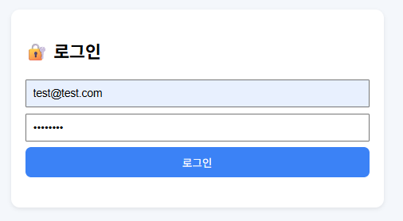
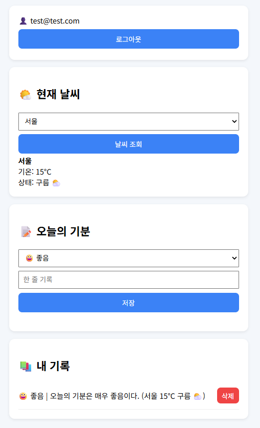

# 우리 동네 날씨 & 오늘의 기분 기록장

## 🔗 배포 링크
https://mj722-a.github.io/1127_-rehearsal/

## 📌 프로젝트 소개
Firebase 로그인 후 지역별 현재 날씨를 조회하고,
오늘의 기분과 한 줄 기록을 Firestore에 저장·삭제하는 웹앱입니다.

## 🌐 사용한 Open API
- **Open-Meteo Forecast API** (https://open-meteo.com) - 인증키 불필요

## 🔑 테스트 계정
- ID: test@test.com
- PW: test1234

## ✨ 주요 기능
1. Firebase 이메일/비밀번호 로그인·로그아웃
2. Open-Meteo API 실시간 현재 기온·날씨 조회
3. Firestore 사용자(uid)별 기분 기록 저장·조회·삭제
4. GitHub Pages 배포

## 🛠 사용 기술
HTML, JavaScript, Firebase Authentication, Cloud Firestore, GitHub Pages

## 📷 실행 화면

